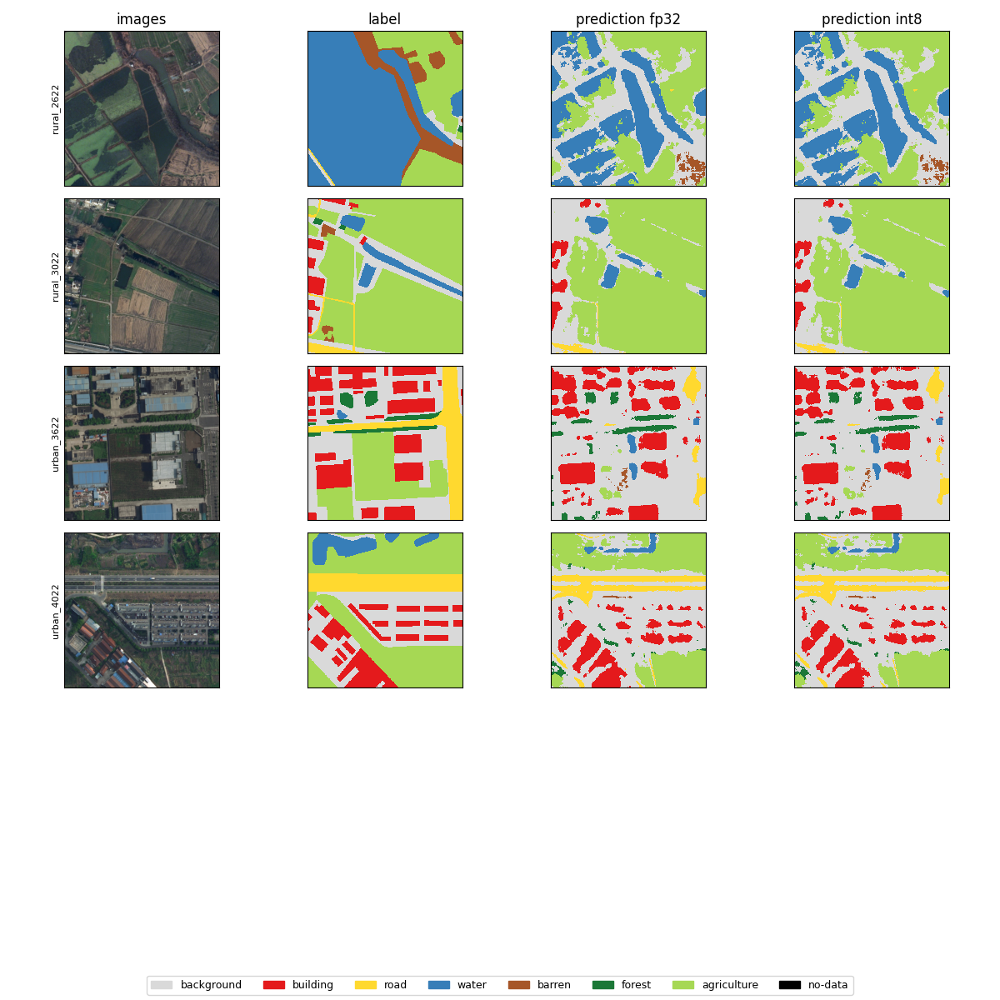
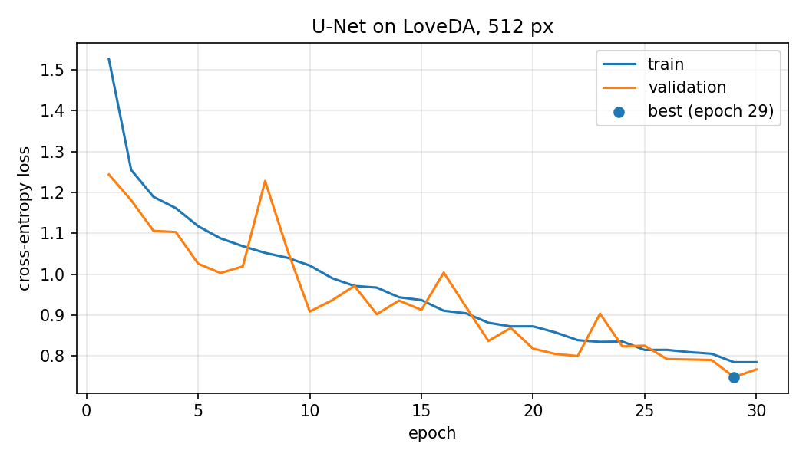

# aerial-seg-edge

Train a small semantic segmentation model on aerial images in PyTorch,
export it to ONNX, and measure what the export changes:
accuracy, model size and CPU inference time.

**Status: work in progress.** The results section is filled in only with
numbers measured by the scripts in this repository.

## Progress

- [x] Data download and statistics
- [x] Preprocessing and PyTorch dataset
- [x] U-Net model and training loop
- [x] Evaluation (mean IoU per class)
- [x] ONNX export and parity check
- [x] Benchmark: model size and CPU latency
- [x] Results table and prediction images

## Data

[LoveDA](https://zenodo.org/records/5706578): aerial images of urban and
rural scenes, 1024 x 1024 px, with 7 land-cover classes.
Measured statistics: [docs/data_stats.md](docs/data_stats.md).
Licence: see [DATA_LICENSE.md](DATA_LICENSE.md).

The official Test split has no public labels. The official Val split is
therefore used as the held-out test set, and a validation set is split
off from Train.

## Setup

```bash
python3 -m venv .venv
source .venv/bin/activate
pip install -r requirements.txt
python scripts/download_data.py    # about 6.4 GB
python scripts/explore_data.py
```

## Results

| Class | PyTorch | ONNX fp32 | ONNX int8 |
|---|---|---|---|
| background | 47.0 | 47.0 | 47.0 |
| building | 39.1 | 39.1 | 38.7 |
| road | 38.5 | 38.5 | 38.0 |
| water | 40.4 | 40.4 | 40.0 |
| barren | 17.8 | 17.8 | 16.8 |
| forest | 38.1 | 38.1 | 38.0 |
| agriculture | 39.0 | 39.0 | 38.3 |
| **mIoU** | **37.1** | **37.1** | **36.7** |



Images and labels: LoveDA (Wang et al., NeurIPS 2021), CC BY-NC-SA 4.0.

On the validation split cut from Train, mIoU is 53.4 %. The 16-point gap
comes from the official Val images covering different regions with a
different class mix (see [docs/data_stats.md](docs/data_stats.md)).

### Size and CPU latency (median of 50 runs after 10 warm-up runs)

| Runtime | Size | 4 threads | 1 thread |
|---|---|---|---|
| PyTorch | 7.81 MB | 94.9 ms | 107.4 ms |
| ONNX fp32 | 7.85 MB | 81.6 ms | 274.1 ms |
| ONNX int8 | 2.05 MB | 34.9 ms | 97.4 ms |

Static int8 quantization (QDQ, per-channel, calibrated on 100 training
images) made the model 3.8× smaller and 2.3× faster than ONNX fp32 with
4 threads, for a loss of 0.4 points mIoU.

PyTorch on macOS likely uses Apple's matrix unit through Apple's math
library, which explains why its single-thread time barely changes. That
figure is therefore not representative of edge hardware without such a
unit. Measuring on an ARM board would be the next step.

### Training



30 epochs, best validation loss 0.748 at epoch 29. Validation loss was
still falling, so a longer run would likely improve the results.

## Licence

Code: MIT. Data: see [DATA_LICENSE.md](DATA_LICENSE.md).